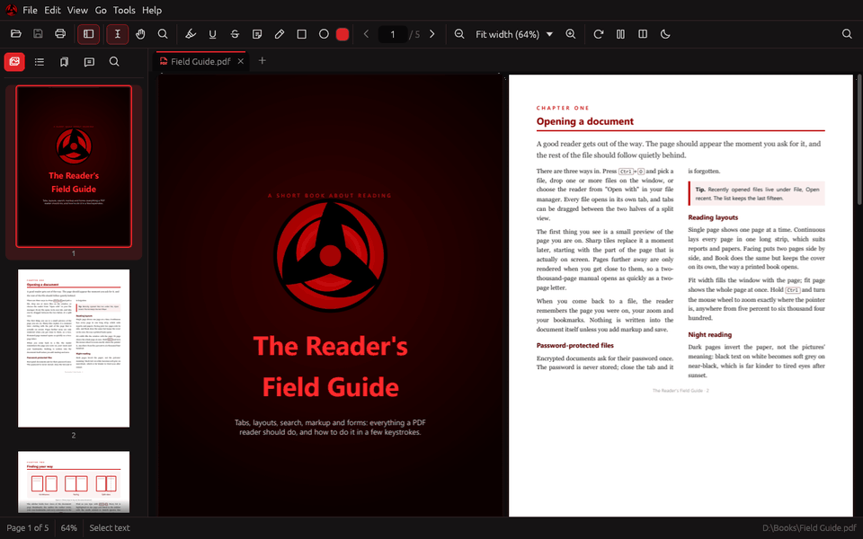
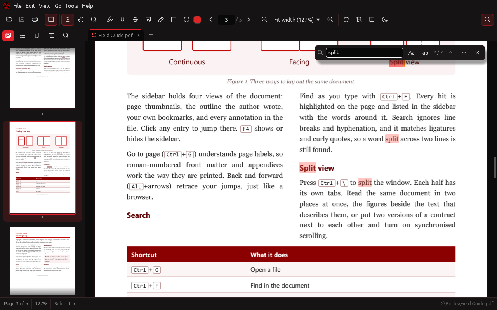
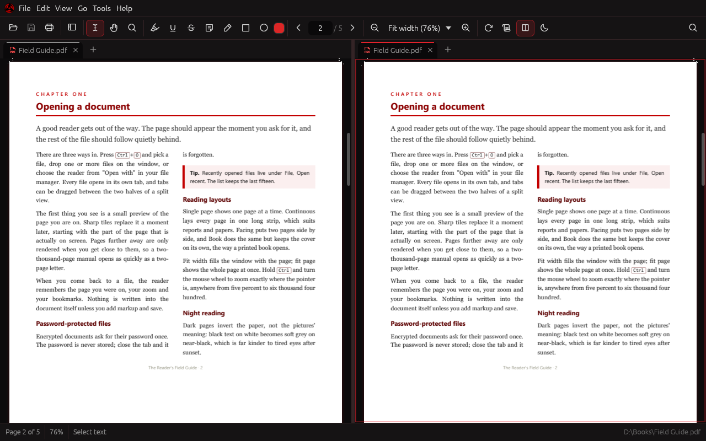

<p align="center">
  
</p>

<p align="center">
  <a href="https://github.com/boode-hub/BDF/releases/latest"></a>
  <a href="#download-and-run"></a>
  <a href="#build-it-yourself"></a>
  <a href="#under-the-hood"></a>
  <a href="https://buymeacoffee.com/boode"></a>
</p>

<p align="center">
  A PDF reader that opens a two-thousand-page manual as fast as a two-page letter.<br>
  Tabs, split view, search, highlights, notes and forms, dressed in Sharingan crimson and black.<br>
  <b>Portable.</b> One folder, no installer, no admin rights, nothing written to the registry.
</p>

<p align="center">
  <a href="#download-and-run"><b>Download</b></a> &nbsp;&bull;&nbsp;
  <a href="#why-bdf"><b>Why BDF</b></a> &nbsp;&bull;&nbsp;
  <a href="#features"><b>Features</b></a> &nbsp;&bull;&nbsp;
  <a href="#shortcuts"><b>Shortcuts</b></a> &nbsp;&bull;&nbsp;
  <a href="#under-the-hood"><b>Under the hood</b></a> &nbsp;&bull;&nbsp;
  <a href="#support"><b>Support</b></a>
</p>

<p align="center"></p>

<p align="center">
  
</p>

<a id="download-and-run"></a>

##  Download and run

*Three steps, under a minute. Never used GitHub before? Just follow along.*

1. **Download** [`BDF-x.x.x-win-x64.zip`](https://github.com/boode-hub/BDF/releases/latest) from the latest release.
2. Right-click the ZIP, choose **Extract All**, and pick any folder (a USB stick works too).
3. Open that folder and double-click **`bdf.exe`**.

That's it. Open a PDF with **File > Open**, by dropping it on the window, or with
**Open with > BDF** in Explorer.

> [!TIP]
> **"Windows protected your PC"?** BDF isn't code-signed yet, so SmartScreen asks
> once. Click **More info**, then **Run anyway**. Or, before extracting, right-click
> the ZIP, choose **Properties**, tick **Unblock**, and extract again.

| What's in the folder | |
| --- | --- |
| `bdf.exe` | the reader |
| `pdfium.dll` | the PDF engine; keep it next to `bdf.exe` |
| `BDF-data/` | your settings, bookmarks and log, created on first run |
| `licenses/`, `README.txt` | credits and a short how-to |

**To uninstall,** delete the folder. Nothing else was ever touched.

> [!NOTE]
> **Old PC or virtual machine and no window appears?** Start it with
> `bdf --renderer wgpu`, or choose **Graphics** in **Preferences**. BDF also
> notices a missing OpenGL by itself, restarts with DirectX, and remembers it.

<p align="center">
  <sub>Reading comfortably? A coffee keeps new features coming.</sub><br>
  <a href="https://buymeacoffee.com/boode"></a>
</p>

<p align="center"></p>

<a id="why-bdf"></a>

##  Why BDF

| | |
| --- | --- |
| **Portable** | Unzip and run. Settings live in `BDF-data/` next to the program, so the whole reader travels on a USB stick or a network share. |
| **Fast** | The page on screen is drawn first, the rest follows behind. On an ordinary office laptop the built-in benchmark opens a 2000-page file in under a second and scrolls it in under 4 ms a frame. |
| **Light** | One small program plus PDFium. Idle CPU is zero: BDF only draws when something changes. |
| **Accurate** | Pages are rendered by PDFium, the engine inside Chrome. |
| **Safe** | Your markup is appended to the file, never rewritten over it, so digital signatures stay valid. The new file is verified before it replaces the old one. |

<p align="center"></p>

<a id="features"></a>

##  Features

<table>
  <tr>
    <td width="50%"></td>
    <td width="50%"></td>
  </tr>
  <tr>
    <td align="center"><b>Find as you type.</b> Every hit highlighted, a results list with context.</td>
    <td align="center"><b>Split view.</b> Two panes, their own tabs, optional synced scrolling.</td>
  </tr>
</table>

| Area | What you get |
|---|---|
| Reading | Tabs; single, continuous, facing and book layouts; fit width / fit page / 5–6400% zoom (Ctrl+wheel zooms at the cursor); rotate; full screen; dark pages for night reading |
| Split view | Two panes side by side or stacked, each with its own tabs; the same document or two different ones; optional synchronised scrolling |
| Navigation | Thumbnails, the document outline, your own bookmarks, page labels, go to page, back and forward, clickable links |
| Search | Find as you type, match case, whole words, all hits highlighted, results list with context; ignores line breaks and hyphenation, matches ligatures and curly quotes |
| Text | Select (drag, double-click a word, triple-click a line, across pages) and copy |
| Markup | Highlight, underline, strikeout, sticky notes, pen, rectangle, ellipse; edit or delete; undo and redo; saved into the PDF so other readers see them |
| Smart highlighting | Selection follows what you see: hidden text (covered, white on white, invisible, switched-off layers, off the page) is ignored, columns are kept apart, and highlights snap to whole words |
| Forms | Fill in text fields, checkboxes, radio buttons, drop-downs and lists; fillable fields are tinted; values save into the PDF |
| Tools | Magnifier loupe, hand tool, middle-mouse panning |
| Files | Open recent, drag and drop, password-protected PDFs, document properties, print |
| Looks | Sharingan crimson and black; Kakashi's Mangekyou logo (or Itachi's, in Preferences), sharp at any display scaling, spinning while pages load |

<p align="center"></p>

<a id="shortcuts"></a>

##  Shortcuts

| Keys | Does | | Keys | Does |
| --- | --- | --- | --- | --- |
| `Ctrl+O` | Open | | `Ctrl+F` | Find |
| `Ctrl+S` | Save | | `Ctrl+G` | Go to page |
| `Ctrl+P` | Print | | `Ctrl+B` | Bookmark this page |
| `Ctrl+W` | Close tab | | `Alt+←` / `Alt+→` | Back / forward |
| `Ctrl+Z` / `Ctrl+Y` | Undo / redo | | `Ctrl+\` | Split view |
| `Ctrl++` / `Ctrl+-` | Zoom in / out | | `F4` | Sidebar |
| `Ctrl+2` / `Ctrl+0` | Fit width / fit page | | `F11` | Full screen |
| `Ctrl+R` | Rotate | | `Ctrl+wheel` | Zoom at the cursor |

**Help > Keyboard shortcuts** inside BDF lists them all.

### Command line

```
bdf [file.pdf ...] [--page N] [--renderer gl|wgpu]
bdf --bench [file] [--report path]   # scripted benchmark of the real app
bdf --generate N out.pdf             # an N-page test PDF
bdf --generate-form out.pdf          # a one-page test form
bdf --list-annotations file.pdf      # what PDFium sees, one line per annotation
```

<p align="center"></p>

<a id="under-the-hood"></a>

##  Under the hood

*Written in Rust with egui. PDFium does the rendering on its own thread; the window never waits for it.*

* **What is on screen is drawn first.** Reading a page's text, links and the
  hidden-text check waits until the visible pages have their images, then the
  next screen and the sidebar thumbnails follow.
* **Tiles, not pages.** Pages are drawn as 1024-pixel tiles, and only the
  visible ones (plus one screen ahead) are rendered. Tiles that scroll away
  before they are drawn are dropped from the queue, so fast scrolling never
  builds a backlog.
* **Never blank.** A small thumbnail shows instantly while the sharp tiles
  render; while you zoom, the previous tiles are stretched until the new ones
  are ready.
* **Bounded memory.** Page images live in a GPU cache with a memory budget
  (Preferences). Search runs one page at a time between renders.

<a id="build-it-yourself"></a>

<details>
<summary><b>Build it yourself</b> (Windows, macOS, Linux)</summary>

Needs Rust 1.88 or newer and the PDFium library.

```sh
scripts/fetch_pdfium.sh win-x64      # or linux-x64, mac-arm64, mac-x64
cargo build --release
cp .pdfium/*pdfium* target/release/
target/release/bdf some.pdf
```

`scripts/package.sh win-x64` produces the portable zip in `dist/`.

</details>

<details>
<summary><b>Tests and benchmarks</b></summary>

```sh
BDF_PDFIUM=$PWD/.pdfium cargo test --workspace     # unit + real-PDFium tests
target/release/bdf --bench --report bench.json      # scripted benchmark of the real app
cargo run --release -p bdf-core --example timing -- file.pdf   # engine cost per step for page 1
python3 scripts/check_bench.py bench.json           # fails if over budget
scripts/ui_smoke.sh target/release/bdf              # Linux: real clicks via xdotool, checks the saved PDF
```

CI (`.github/workflows/ci.yml`) runs formatting, clippy, all tests and the
benchmark on Windows, macOS and Linux, enforces the performance budget in
`scripts/check_bench.py`, and uploads the portable zips. Tagging `v*`
publishes a release.

The UI test drives the real window with the mouse (highlight, pen, rectangle,
Edit > Undo, File > Save, ticking a form checkbox) and then checks what the
saved file contains.

The engine tests cover rendering, tiles stitching into whole pages, rotation
geometry, text and links, annotations surviving an in-place save, passwords,
and 150 truncated or corrupted files opened without a crash.

</details>

<details>
<summary><b>Layout of the code</b></summary>

```
crates/bdf-core   document engine, no UI; fully unit tested
  pdfium.rs       PDFium through its C API (the only unsafe code)
  worker.rs       engine thread: priorities, cancellation, search jobs
  layout.rs       page positions for every layout mode
  geom.rs         PDF space <-> screen space, rotation
  text.rs         search over extracted text
  visual.rs       selection by visible lines and columns (smart highlighting)
  cache.rs        byte-bounded LRU for page images
  settings.rs     portable settings, per-document memory
  testpdf.rs      tiny PDF writer for tests and benchmarks
crates/bdf        the application (egui)
  view.rs         one document view: scrolling, zoom, tiles, tools
  app.rs          tabs, panes, engine responses, commands, shortcuts
  chrome.rs       menus, toolbar, tab strip, status bar, find bar
  sidebar.rs      thumbnails, outline, bookmarks, annotations, results
  dialogs.rs      modal dialogs
  print.rs        Windows GDI printing; CUPS on macOS/Linux
  bench.rs        `bdf --bench` scripted benchmark
```

</details>

<p align="center"></p>

<a id="support"></a>

##  Support

If BDF saves you time, a coffee is the best thank-you. Bug reports and ideas
are welcome in [Issues](https://github.com/boode-hub/BDF/issues).

<p align="center">
  <a href="https://buymeacoffee.com/boode"></a>
</p>

## Credits

The logo is Kakashi's (or Itachi's) Mangekyou Sharingan from the vector eyes of
[Sharingan-Monitor](https://github.com/boode-hub/Sharingan-Monitor) (MIT).
PDFium: BSD-3-Clause. Phosphor icons: MIT. egui: MIT/Apache-2.0.
